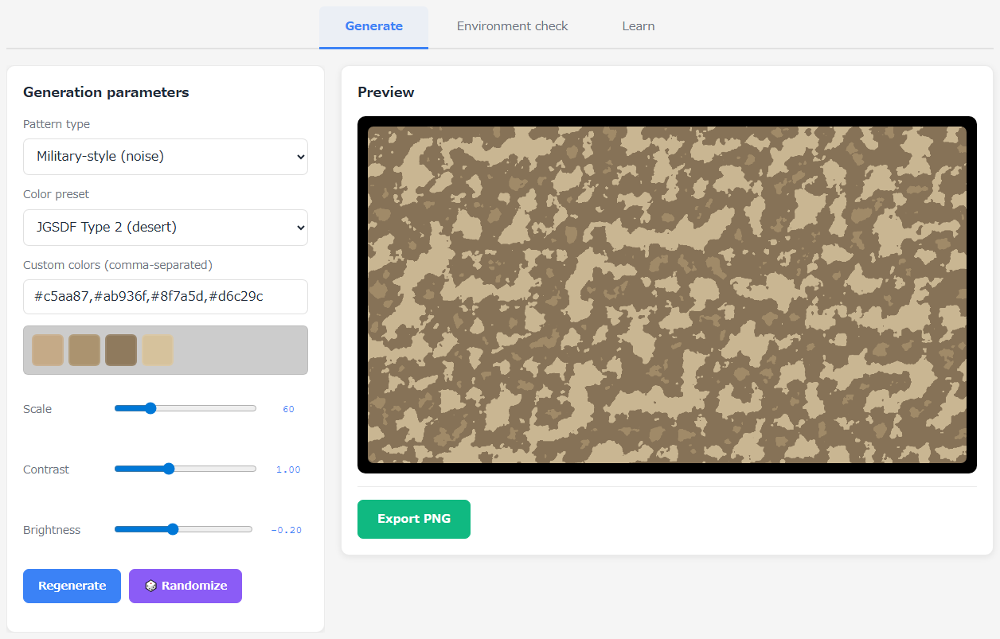
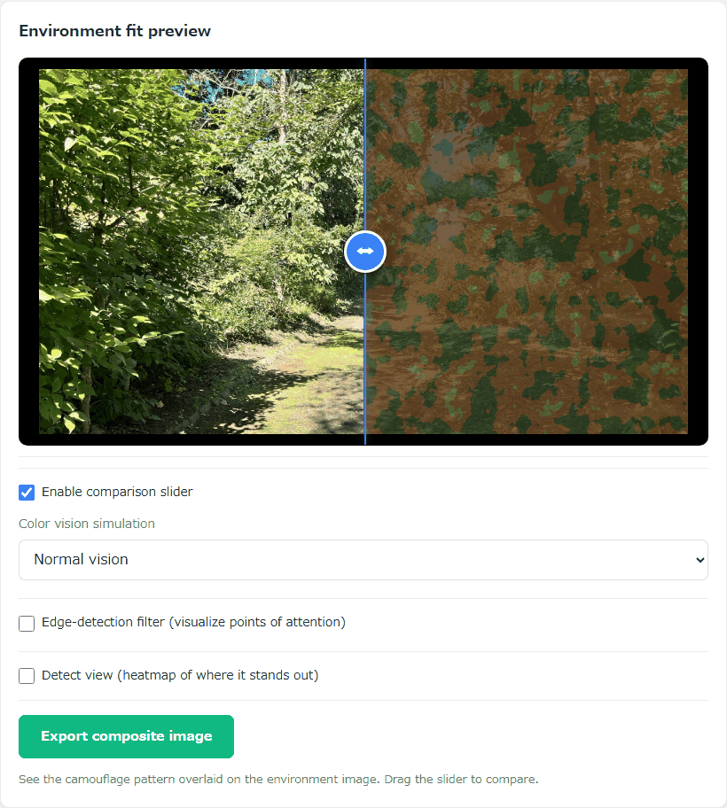
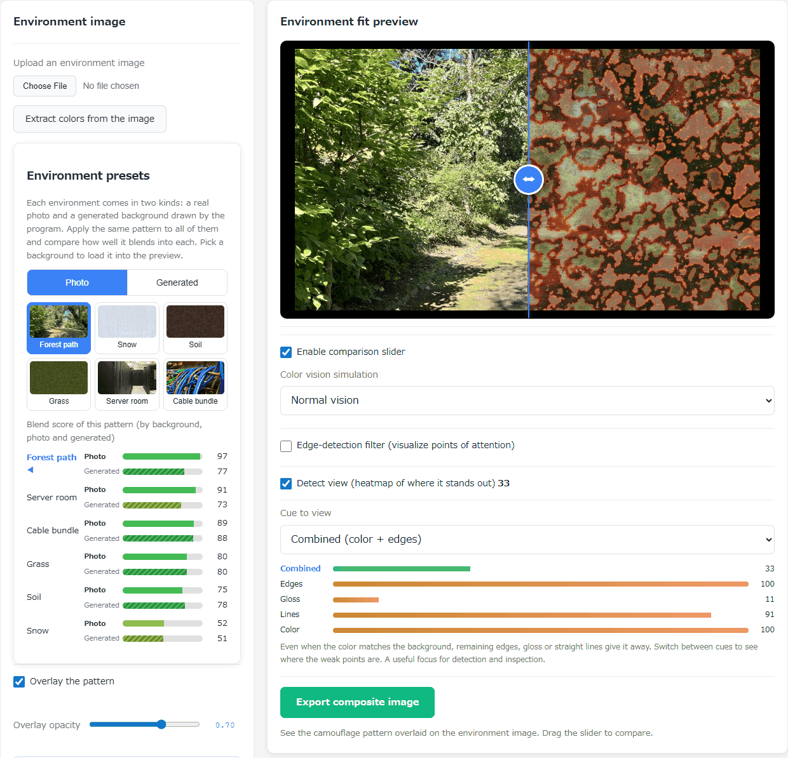
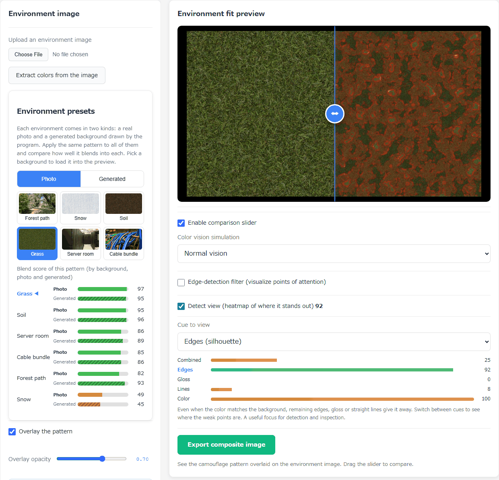
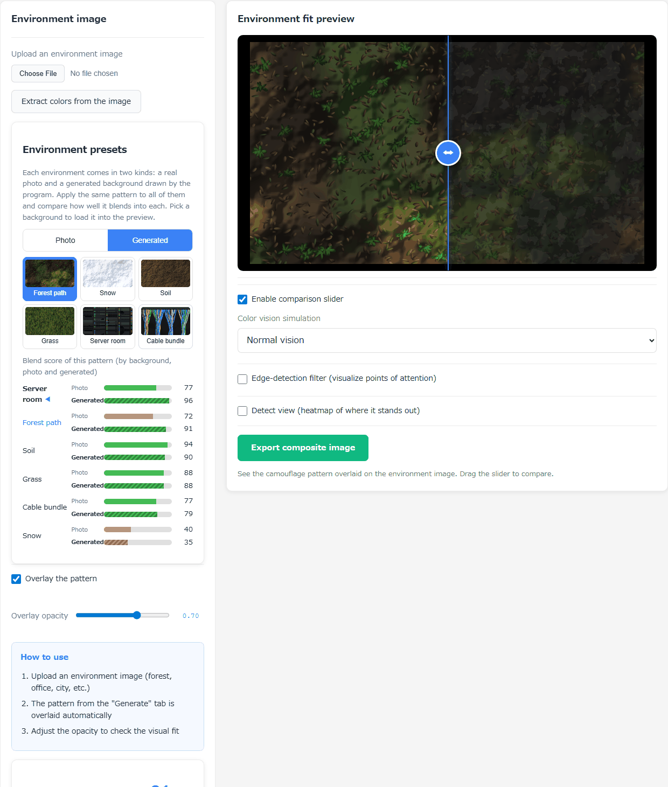
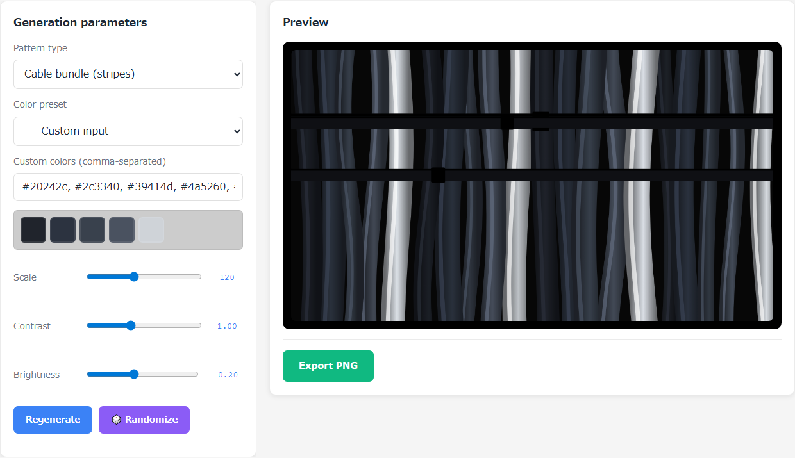

English · [日本語](README.md)

# CamoForge - A Camouflage Design Generator


[](https://ipusiron.github.io/camoforge/)


**Day085 - 100 Security Tools with Generative AI**

**CamoForge** is a web-based tool that generates camouflage designs and lets you overlay them on an environment image to check "how they look".

- Camouflage pattern generation (Perlin noise, stripes, panel patterns, and more)
- Over 20 military camouflage palettes built in (Woodland BDU, MARPAT, MultiCam, and others)
- **Color vision simulation**: check how the camouflage looks under protan, deutan and tritan color vision and monochrome vision
- Preview on top of an environment photo (opacity adjustment, comparison slider, edge detection)
- A "Learn" tab for background knowledge
- Save the result as a PNG
- Japanese / English interface (toggle at the top right)

With an environment-fit check that integrates color vision simulation, you can **evaluate a camouflage pattern from the viewpoint of observers with color-vision diversity (color vision deficiency)**.
This can be called a rare implementation, even worldwide, that combines security education, accessibility and design verification.

---

## 🌐 Demo

👉 **[https://ipusiron.github.io/camoforge/](https://ipusiron.github.io/camoforge/)**

You can try it directly in your browser.

---

## 📸 Screenshots

>
>*Generating the camouflage "JGSDF Type 2 (desert)"*
>
>
>*Overlaying Woodland BDU on the photo "Forest path" (comparison slider)*

---

## ⚙️ Features

### 1️⃣ Generate tab

Generate a camouflage pattern and adjust its parameters.

- **Pattern types** (6)
  - Military-style (noise): natural camouflage based on Perlin noise
  - Digital camo (pixel): digital camouflage made of square pixels
  - Cable bundle (stripes): imitates bundles of cables in offices and server rooms
  - Hardware panel (grid): imitates equipment panels and vents
  - Matte black (vignette): an optical-black texture for dark places
  - Custom noise: parameters adjusted freely

- **Color presets** (over 50)
  - Military camouflage: 20, including Woodland BDU, MARPAT (woodland/desert), MultiCam, OCP, Flecktarn, and JGSDF Type 1/Type 2
  - Cable bundles: 10, including Dark Neutral, Graphite, Charcoal Mix and Off-White Bundle
  - Hardware panels: 10, including Gunmetal, Anthracite and Brushed Steel
  - Office backgrounds: 10, including Wall White, Wood Desk, Carpet and Ceiling Grid

- **Parameters**
  - Scale: 8–300 (size of the pattern)
  - Contrast: 0.2–2.5 (strength of light and dark)
  - Brightness: -1.0–1.0 (overall lightness)

- **Randomize**: randomizes the colors and parameters while keeping the current pattern type

- **PNG export**: saves the generated pattern as a 1280×720 px image

### 2️⃣ Environment check tab (this tool's own feature)

CamoForge's biggest feature is the **environment-fit check with integrated color vision simulation**.
It offers a feature not found in other camouflage pattern generators, bringing together accessibility and security education.

#### Uploading an environment image
- **Formats**: JPEG, PNG, GIF, WebP, BMP
- **File size limit**: up to 10 MB
- **Client-side processing**: uploaded images are not sent to any external server

#### 📊 Comparison slider
- **Before/after comparison**: compare "environment only" ⇄ "camouflage overlaid" visually with a draggable slider
- **Opacity**: adjust the opacity of the camouflage pattern from 0.0 to 1.0
- **Real-time preview**: see the result as soon as you move a slider

#### 🎚️ Blend score

>
>
>*Environment check (blend score, detect view and color extraction from the environment image)*

Shows as a number (0–100) how well the pattern blends into the environment image.
The blend score is calculated from three gaps: closeness of color, brightness and contrast.
Even when the colors match, the pattern is found if edges or differences in light and dark remain in the detect view below.

#### 🔍 Detect view

Overlays a heatmap of where the composite stands out.
It combines the edges of the composite (local changes in brightness) with the deviation from the background's local mean, and gives how conspicuous each pixel is.
It shows that even when you match the colors to the background, remaining edges or gloss give it away. It is a starting point for what to look at in detection and inspection.

#### 🧭 Breaking down the detection cues

>
>
>*Detect view extensions (switch between combined, edges, gloss, lines and color difference to see the weak points cue by cue)*

When the detect view is on, you can switch between four cues by which something is found.

- **Edges (silhouette)**: luminance gradient. The outline of an object stands out against the background
- **Gloss (highlights)**: spots brighter than the surroundings. Reflections of non-matte surfaces or connectors
- **Straight lines (man-made edges)**: places where strong edges continue straight. Straight lines of equipment, cables and panels are rare in nature
- **Color difference**: deviation in color from the background's local mean

The score for each cue is listed, so even when the colors match you can see weak points such as "the edges remain" or "the straight lines stand out". It is training for the finding side (detection and inspection), not the hiding side.

#### 🎨 Extracting colors from the environment image

Picks the colors used most in the uploaded environment image with k-means and puts them into the palette.
You can make camouflage in colors specific to that background, so you can try out directly the principle that "camouflage can only be evaluated against a background".

#### 🗺️ Environment preset comparison

>
>
>*Environment preset comparison (the same pattern scored against the photo and the generated background of six environments)*

Even without uploading an image, the same pattern is applied to built-in backgrounds and their blend scores are listed.
There are six environments, forest path, snow, soil, grass, server room and cable bundle, each with two kinds of background.

- Photo: a photograph of the real thing. Snow, soil and grass are materials shot straight down at the ground; the server room and the cable bundle are photos of real equipment
- Generated: a background drawn by the program. The ground is drawn with layered noise and shading, and pebbles, leaves, cables, racks and so on are placed on it. It is determined by a seed, so the picture is the same every time

Switch with "Photo | Generated" on the screen. Switching loads the other kind of the environment being shown.
The comparison has two bars per environment, one for the photo and one for the generated background (the generated bar is hatched).
Green camouflage blends well into grass but stands out on snow; the same camouflage gives different results depending on the background. You can confirm with numbers that "there is no universal camouflage".
It can also happen that a pattern blends into the generated background but stands out in the photo. The gap between the two bars shows how evaluating camouflage only against made-up backgrounds can mislead.
Selecting a background loads it into the preview, so you can check the blend score and detect view above against that background. At startup "Photo · Forest path" is selected.

**Photo credits**

| Environment | Source | Site | License | Processing |
|---|---|---|---|---|
| Forest path | Forest path | Taken by the author | — | — |
| Snow | [Snow 005](https://ambientcg.com/a/Snow005) | ambientCG | CC0 1.0 | Shading baked in from the normal map and AO |
| Soil | [Ground 048](https://ambientcg.com/a/Ground048) | ambientCG | CC0 1.0 | Shading baked in from the normal map and AO |
| Grass | [Grass 004](https://ambientcg.com/a/Grass004) | ambientCG | CC0 1.0 | Shading baked in from the normal map and AO |
| Server room | [Front of server racks at NERSC](https://commons.wikimedia.org/wiki/File:Front_of_server_racks_at_NERSC.jpg) (Derrick Coetzee) | Wikimedia Commons | CC0 1.0 | Cropped to 16:9 |
| Cable bundle | [EthernetSwitch2](https://commons.wikimedia.org/wiki/File:EthernetSwitch2.jpg) (Raysonho @ Open Grid Scheduler / Grid Engine) | Wikimedia Commons | CC0 1.0 | Cropped to 16:9 |

- The photos are 1280×720, and the thumbnails used for the buttons and scoring are 320×180. None of them carry camera or location data (EXIF)
- ambientCG color maps are the bare color with no light on it, so shading from an upper-left light was added from the bundled normal map and AO (ambient occlusion)

#### 👁️ Color vision simulation (this tool's own strength)

**Why does it matter?**
How effective a camouflage pattern is does not "look the same to everyone".
From the viewpoint of people with color-vision diversity (color vision deficiency, color weakness), it looks entirely different from normal vision.

From the viewpoint of different color-vision characteristics, such as red-green color vision deficiency (protan and deutan) or tritan with weak discrimination of blues, contrasts the designer did not expect can be emphasized.

In fact, cases are known where observers with red-green color weakness see emphasized "differences in lightness" that people with normal vision do not, so that some camouflage stands out instead.

- **Normal vision**: common trichromatic color vision
- **Protanopia**: hard to tell reds apart. Reddish-brown camouflage looks close to green
- **Deuteranopia**: hard to tell greens apart. Woodland camouflage looks close to brown
- **Tritanopia**: hard to tell blues apart. The blue-gray of urban camouflage changes
- **Monochrome (achromatopsia)**: no color information; judged by contrast alone

**Implementation**: color-space conversion by matrix transformation (RGB → RGB of each color vision type)

When you switch the color vision, not only the preview but also the blend score and the environment preset comparison are scored as seen with that color vision. The same conversion is applied to both the pattern and the background before they are compared.

**Practical significance**
1. **Security education**: learn by experience the fact that "camouflage relying on color alone does not work for some observers"
2. **Design verification**: design patterns with color-vision diversity in mind, from a universal-design perspective
3. **Visual perception research**: teaching material for feeling the diversity and limits of the human visual system

**What sets it apart from other tools**
- Tools that can apply color vision simulation **to the composite of a camouflage pattern and an environment image** are extremely rare
- Switching in real time lets you instantly find patterns that "blend in under normal vision but stand out to people with color weakness"
- A one-of-a-kind educational tool that spans three fields: security, accessibility and design

#### 🔍 Edge-detection filter
- An edge-enhancement filter using the **Sobel operator** (a standard computer-vision technique)
- **Visualizing points of visual attention**: find where the camouflage breaks down (where edges are strong)
- **Detection training**: experience "detecting man-made objects" from a computer-vision viewpoint

#### Composite export
- Save the composite of the environment image and the camouflage pattern as a PNG

### 3️⃣ Learn tab

Educational content on the history, theory and applications of camouflage patterns.

- **Principle of camouflage**: the essence of "becoming one with the background"
- **Historical background**: military camouflage in World War I, research on mimicry in nature
- **Modern trends**: urban camouflage, digital camouflage (MARPAT and others), multi-scale camouflage (MultiCam), applications to art and design
- **Where it is used**: military / hunting / industrial design / stage art / education
- **Physical and cyber**: physical camouflage = visual noise, cyber camouflage = obfuscation and tracking avoidance
- **Human factors**: consideration for color-vision diversity, the importance of readability in UI design
- **Notes on real devices**: the limits of camouflage and detection methods for a Raspberry Pi, USB devices, wireless APs and so on
- **Animal camouflage (mimicry in nature)**: background matching, disruptive coloration, countershading, changing color with the seasons, mimicry, staying still
- **Educational summary**: the cues man-made objects leave, and the need to detect by combining vision, sensors and communication behavior

---

## 📜 History of camouflage patterns and observations

- **Multi-Terrain Pattern (MTP)**
  For soldiers moving between woodland and desert areas of operation, the British Army developed a new camouflage pattern with a fine balance that works in both. It is a "Multi-Terrain Pattern" that does not depend too much on the background and works effectively across a wide range of environments.

- **MARPAT**
  The US Marine Corps uses a digital camouflage pattern (MARPAT) that applies high technology. Instead of the traditional "large blotches", it uses a collection of fine pixelated rectangles, which induces visual illusions and makes detection harder.

- **The gap between nature and man-made objects**
  Nature produces irregular, random patterns, especially where different kinds of leaves mix.
  People, on the other hand, like to make patterns by arranging the same shape regularly. This "regularity" is one of the things that make man-made objects stand out.
  An example that overcomes this gap is the **ghillie suit**, which blends into the background by wearing natural materials such as grass and branches.

- **Differences in tone**
  People tend to use primary colors, but the colors of nature are soft and muted. This difference also makes man-made objects stand out.
  Ideal camouflage is a state in which the person or object wearing it looks as close to one with the background as possible.

---

## 🔬 Further observations with CamoForge

CamoForge can generate camouflage patterns for "backgrounds specific to man-made objects" such as the following.

### Matte black pattern (Black Matte)
- **Characteristics**: imitates the texture of a "jet black" that reflects almost no light. It can reproduce a look close to the "optical black" used in stage art and optical instruments.
- **Observations**: next to dark places or black cable bundles, outlines weaken and it becomes hard to notice. On a bright background, however, it becomes a strong silhouette instead, so it is not universal.
- **Security implications**: even if it works in visible light, outlines and temperature differences remain for near-infrared and thermal cameras, so complete concealment is not possible.

### Cable bundle pattern (Cable Bundle)

>
>
>*Cable bundle pattern (thickness, color, gloss, meandering and cable ties)*

- **Characteristics**: imitates the bundles of black to gray cables common in offices and server rooms. Several cables of different thicknesses and colors are drawn with meandering, overlaps (depth), gloss (highlights) and cable ties. The number of cables changes with scale, the strength of gloss and shading with contrast, and the brightness of the background with brightness.
- **Observations**: color is not the only cue for recognizing cables as a bundle. Only when the variation in thickness, gloss, meandering and cable ties are all there does something look like "part of the bundle". To make a surface blend into a bundle, these cues must be matched together.
- **Security implications**: in such environments, "camouflage that blends into a familiar man-made background" works, and there is not always a need to imitate patterns from nature.

### Hardware panel pattern (Hardware Panel)
- **Characteristics**: imitates the grids, vents and screws seen on server panels and router housings.
- **Observations**: mixing artificial rectangles and slits with random elements reduces monotony and produces the look of "a panel that should really be there".
- **Security implications**: the idea of reproducing the background itself. Camouflage can be applied not only to "looking natural" but also to "being mistaken for part of the environment".

---

## 🎭 The essence of camouflage is "becoming one with the background"

The essence of camouflage is **"becoming one with the background"**.
In natural environments you match the randomness of leaves and soil; in man-made environments you match the familiar patterns of cables and panels.

CamoForge is an educational tool for learning that difference by experience, and it is a foothold for exploring issues such as the following.
- The "regularity gap" between nature and man-made objects
- Tone (primary colors vs. muted colors)
- Vision vs. sensors at other wavelengths (NIR, thermal)

These issues span both security and design.

---

## 🖥️ Observations on camouflaging real devices

Here the camouflage patterns generated with CamoForge are considered with the look of real devices in mind.

### Small computers (Raspberry Pi and others)
- **Characteristics**: the green board, black chips and connectors stand out. Placed on a desk or in a rack, its "board-like appearance" is recognized at once.
- **Observations**: covering it entirely with the matte black pattern makes it inconspicuous in the dark, but the board's terminals and LEDs stand out as strong "artificial signals".
- **Educational point**: even if it seems to blend into the environment, a security administrator can find it by paying attention to "unnatural terminals" and "wiring patterns".

### USB devices (dongles and storage)
- **Characteristics**: small, single-color plastic housings. Used sticking out of a USB port.
- **Observations**: placed among black or gray cable bundles it blends in visually, but its silhouette as a protrusion remains.
- **Educational point**: observers should detect "elements that break a regular arrangement"; a camouflage pattern alone cannot make it blend in completely.

### Wireless access points (assuming a rogue AP)
- **Characteristics**: often small white housings and antennas. Installed on a ceiling or wall, they can be hard to tell apart from "legitimate equipment".
- **Observations**: overlaid on office background patterns (white walls or ceiling grids), they are hard to notice. However, vents and the light of LED lamps are artificial and stand out.
- **Educational point**: even if the color and pattern blend into the background, communication behavior and blinking LED lamps are decisive clues for discovery.

### Network equipment (routers and hubs)
- **Characteristics**: the row of front ports, vents and status LEDs make it more visible.
- **Observations**: with the hardware panel pattern it looks as if it "blends" into the whole rack, but occupied ports and lit LEDs are easily seen through.
- **Educational point**: visual camouflage alone is not enough; detection that includes **functional signals (communication, light, heat)** is essential.

### Educational summary

- **Man-made objects always leave man-made cues**: terminals, LEDs and regular arrangements do not exist in natural environments.
- **What CamoForge offers**
  - Learn by visualizing "why man-made objects stand out"
  - Experiment with "how something looks blended in"
  - Understand the need to detect by combining not only vision but also sensors and communication behavior

---

## 🎯 Who this tool is for

This tool is intended for people such as the following.

- **Security researchers and educators**: as teaching material for the principles of physical security and visual detection
- **Designers and creators**: design experiments with camouflage patterns and artwork production
- **Accessibility specialists**: as a design verification tool that considers color-vision diversity
- **Students and researchers**: learning material for visual perception, computer vision and psychology
- **Game developers**: verifying camouflage effects in character and environment design
- **Stage designers and video producers**: checking visual harmony with the background in advance
- **Security engineers**: training in detection with surveillance cameras and physical security assessment

---

## 💡 Concrete usage scenarios

### Ways of using this tool in particular

CamoForge does not only "make camouflage"; it can score the camouflage you made against a background. The uses that set it apart from other pattern generators are as follows.

- With the environment preset comparison, apply the same camouflage to a forest path, snow, soil, grass, a server room and a cable bundle, and see in one list which backgrounds it blends into and which it stands out against. Confirm "there is no universal camouflage" with a pattern you made yourself
- Put the photo and generated scores of the same environment side by side and look for environments with a large gap. If a pattern blends into the generated background but stands out in the photo, you can show concretely the danger of evaluating only against made-up backgrounds (simulations or test environments). It also becomes a procedure for checking the gap from live footage in film and game production, where how things hide is studied against CG backgrounds
- Switch the color vision and look at the comparison again, searching for environments whose ranking changes only as seen with a particular color vision
- Extract colors from an environment image, make camouflage in colors specific to that site, and confirm with numbers that the blend score goes up
- With the detect view, find places where edges, gloss or differences in light and dark remain even though the colors match. This is training for the finding side (detection and inspection), not the hiding side
- Switch between the detection cues, divided into edges, gloss, lines and color, and check in one list which cue is the weak point of the same camouflage (lines and gloss tend to appear on man-made objects and are cues for telling them apart from natural ones)
- Apply color vision simulation to the composite and find patterns that blend in under normal vision but stand out under a particular color vision

### Scenario 1: Security education "Color-vision diversity and the limits of detection"

**Situation**: teaching the importance of physical intrusion detection in a company security training

**How to use it**
1. Upload a photo of the office environment
2. Generate a "Hardware panel" pattern and overlay it on the environment
3. In **normal vision mode**, confirm that it "looks as if it blends into the background"
4. Switch to **color vision simulation (protan or deutan)**
5. Demonstrate that "depending on the color vision type, it stands out instead"

**Learning outcomes**
- Understand by experience the fact that "camouflage relying on color alone is not universal"
- Recognize that a monitoring system needs "multiple means of detection (motion detection, temperature, communication)"
- Learn the importance of inclusive security design

---

### Scenario 2: Accessibility design verification "Checking the visibility of UI elements"

**Situation**: you want to verify that the color scheme of a website or app takes color-vision diversity into account

**How to use it**
1. Upload a design mockup image
2. Generate a contrast pattern of the background and foreground colors
3. Check how it looks for each color vision type with **color vision simulation**
4. Evaluate "whether it can be identified by shape" with the **edge-detection filter**
5. Verify that elements can be told apart not only by color but also by shape and contrast

**Learning outcomes**
- Understand the contrast requirements of WCAG (Web Content Accessibility Guidelines) visually
- Experience the viewpoint of users with color vision deficiency
- Gain practical skills in universal design

---

### Scenario 3: Game development "Balancing the camouflage effect in a stealth game"

**Situation**: considering the camouflage uniform design for the player character in a stealth action game

**How to use it**
1. Upload screenshots of in-game environments (forest, city, snowfield)
2. Generate camouflage patterns for each environment (Woodland, Urban Gray, whites for snowfields)
3. Evaluate visually "how well it blends into the background" with the **comparison slider**
4. Identify "the spots where the player is easy to find" with **edge detection**
5. Choose a pattern that is "found to a reasonable degree" according to the game balance

**Learning outcomes**
- Feel the "balance between visibility and gameplay" in game design
- Understand how the best camouflage pattern differs by environment
- Develop more efficiently by checking in advance before play testing

---

## Color theory in camouflage design

Camouflage is not merely a design or pattern; its effect of blending into the background can be increased by precisely adjusting **hue, lightness and saturation (the three attributes of color)**.
In other words, learning color theory is useful for camouflage design.

### The three attributes of color and the camouflage effect

#### Hue

The more you use the same "hue range" as the background, the more naturally the camouflage blends into the view.
In forests green and brown are the base, in deserts tan (yellow ocher) and greige, and in snowfields whites.

If the hue difference from the background is large, the outline stands out no matter how complex the pattern is.

#### Lightness

Lightness is especially important among the elements of the camouflage effect.
In dim light, human vision becomes weaker at recognizing hue and only lightness contrast remains, so at night and in dark areas "the difference in brightness rather than color" decides the outcome.

If the lightness balance of a camouflage pattern is off, the outline stands out in the dark, so adjusting it to the lightness of the background is essential.

#### Saturation

Saturation is "vividness".
In dusty regions muted low-saturation colors make up the background, and in a forest after rain vivid high-saturation colors.

Getting the saturation wrong creates "color noise" that stands out from the mood of the background and spoils the camouflage effect.

### Working with Color Hack Box

Color Hack Box is an interactive tool for learning color theory by experience.

- [Color Hack Box](https://ipusiron.github.io/color-hack-box/) - an interactive tool for learning color theory by experience (Day101)

CamoForge handles the "shape" of camouflage patterns, and Color Hack Box handles the "color" based on color theory.
Adjusting shape and color well makes more practical camouflage design possible, such as the following.

- Blends naturally into the background
- Also accommodates color-vision diversity
- Can be optimized for each environment

The essence of camouflage is to look like the background.
That needs both pattern and color, and CamoForge and Color Hack Box work as a set of tools for exactly that purpose.

---

## 🔧 Technical specifications

- HTML / CSS / JavaScript (Vanilla)
- Drawing camouflage patterns with the Canvas API
- Generating natural-looking patterns with Perlin noise
- **Color vision simulation**: color-space conversion by matrix transformation (Protanopia/Deuteranopia/Tritanopia/Monochrome)
- **Edge detection**: edge extraction with the Sobel operator
- Client-side processing only (uploaded images are not sent anywhere)

---

## 🚨 Notes

- This tool is **for education, research and design use only**.
- Using high-absorption materials on real equipment carries safety risks (impeded heat dissipation, temperature rise), so always experiment with mock-ups.
- Be mindful of accessibility (especially color-vision diversity) and use means of identification other than color as well.

---

## 📁 Directory structure

```
camoforge/
├── index.html              # Main HTML file (3 tabs)
├── style.css               # Stylesheet (dark/light mode)
├── .nojekyll              # GitHub Pages setting (disables the Jekyll build)
│
├── js/                     # JavaScript files
│   ├── theme-init.js      # Decides the theme (dark/light) before the first paint
│   ├── color-utils.js     # Color utilities (hexToRgb and others; DOM-free, tested)
│   ├── color-vision.js    # Color vision conversion (DOM-free, tested)
│   ├── cable-plan.js      # Cable-bundle layout plan (determined by a seed, tested)
│   ├── blend-score.js     # Blend score (DOM-free, tested)
│   ├── palette-extract.js # Color extraction from an environment image (DOM-free, tested)
│   ├── detect-map.js      # Heatmap of conspicuous places (DOM-free, tested)
│   ├── env-presets.js     # Drawing the environment presets (generated) and comparing blend scores (DOM-free, tested)
│   ├── env-photos.js      # List of files and credits for the environment presets (photos) (tested)
│   ├── detect-cues.js     # Breaking down the detection cues (edges, gloss, lines, color; DOM-free, tested)
│   ├── messages.js        # Japanese/English dictionary of the interface text
│   ├── i18n.js            # Japanese/English switching of the interface
│   ├── perlin.js          # Perlin noise library
│   └── main.js            # Main logic (UI control, drawing, filters)
│
├── data/                   # Data files
│   └── presets.json       # Color preset definitions (over 50; English names in label_en)
│
├── test/                   # Automated tests (node --test)
│   ├── load.js            # Helper that loads js/*.js into the tests
│   ├── color-utils.test.js # Checks the color utilities
│   ├── cable-plan.test.js # Checks the cable-bundle plan
│   ├── blend-score.test.js # Checks the blend score
│   ├── palette-extract.test.js # Checks color extraction
│   ├── detect-map.test.js # Checks the conspicuous places
│   ├── env-presets.test.js # Checks the environment presets (generated)
│   ├── env-photos.test.js # Checks the environment presets (photos): present, size, no EXIF, credits
│   ├── color-vision.test.js # Checks the color vision conversion and that the page applies it only once
│   ├── theme-init.test.js # Checks the theme decision before the first paint
│   ├── detect-cues.test.js # Checks the detection cues
│   ├── presets.test.js    # Checks that no Japanese remains in the English preset names and group names
│   ├── messages.test.js   # Checks the Japanese/English dictionary keys match
│   ├── html.test.js       # Checks the CSP and elements of index.html
│   ├── readme.test.js     # Checks the README wording and the correspondence of the Japanese/English headings
│   └── format.test.js     # Checks line endings, line length and so on
│
├── .github/workflows/      # GitHub Actions
│   └── test.yml           # Runs npm test on push and pull request
│
├── assets/                 # Image assets
│   ├── background.jpg     # Photo for the environment preset "Forest path" (taken by the author)
│   ├── env/               # Photos for the environment presets (snow, soil, grass, server room, cable bundle; 1280×720)
│   │   └── thumb/         # Thumbnails for the buttons and scoring (6 environments; 320×180)
│   ├── screenshot.png     # Screenshot 1
│   ├── screenshot2.png    # Screenshot 2
│   ├── screenshot3.png    # Screenshot 3 (cable bundle)
│   ├── screenshot4.png    # Screenshot 4 (environment check)
│   ├── screenshot5.png    # Screenshot 5 (environment preset comparison)
│   ├── screenshot6.png    # Screenshot 6 (breaking down the detection cues)
│   └── en/                # Screenshots of the English interface (for README.en.md)
│
├── package.json            # npm test definition (no dependencies)
├── README.md               # Project description (Japanese)
├── README.en.md            # Project description (English)
├── CLAUDE.md               # Developer documentation (for Claude Code)
├── LICENSE                 # MIT License
└── .gitignore             # Git ignore settings
```

### Roles of the main files

- **index.html**: defines the structure of the application. Implements three tabs (Generate, Environment check, Learn)
- **style.css**: responsive design, theme switching with CSS variables, styles for the comparison slider
- **js/main.js**:
  - Pattern generation logic (six drawing algorithms)
  - Edge detection (Sobel operator)
  - Compositing with the environment image, switching the environment presets (Photo | Generated) and the comparison
- **js/color-vision.js**: color vision simulation (color-space conversion by matrix transformation)
- **js/env-presets.js, js/env-photos.js**: generating the environment presets, and the list and credits of the photos
- **js/perlin.js**: Perlin noise generation (for natural camouflage patterns)
- **data/presets.json**: color definitions for 20 military camouflages and 10 each for cables, hardware and office backgrounds

---

## 📄 License

MIT License – see [LICENSE](LICENSE) for details.

---

## 🧪 Tests

```
npm test
```

- Runs on Node.js 22 or later. There are no dependency packages (`node --test`).
- GitHub Actions runs it automatically on every push and pull request.
- It checks the color utilities (expanding 3-digit HEX and so on), that the cable-bundle plan is reproduced with the same seed, the blend score, color extraction from an environment image, the heatmap of conspicuous places, generating the environment presets (the same picture at any resolution) and comparing blend scores, that the photos are present, sized, without EXIF and credited, the color vision conversion and that the page applies it only once, breaking down the detection cues (edges, gloss, lines, color), the theme decision, that no Japanese remains in the English display (preset names, dictionary, index.html), the Japanese/English dictionary keys, the CSP and elements of index.html, and the README wording and the correspondence of the Japanese/English headings.
- Drawing on the page and tab operations were checked with Playwright (the checking scripts are not included in the repository).

---

## 🛠 About this tool

This tool was developed as part of the "100 Security Tools with Generative AI" project.
In this project, a wide range of security-related tools are built and published over 100 days with the help of AI.

For details of the project and the other tools, see the following page.

🔗 [https://akademeia.info/?page_id=42163](https://akademeia.info/?page_id=42163)
